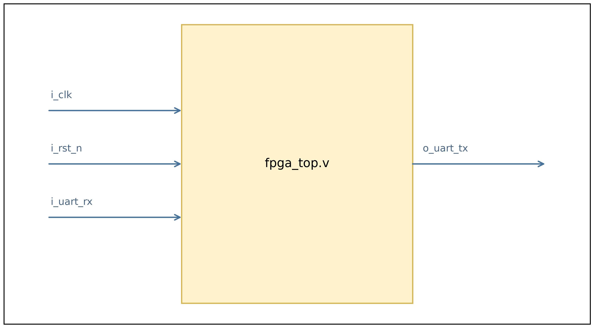
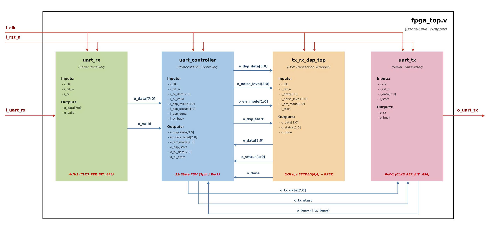
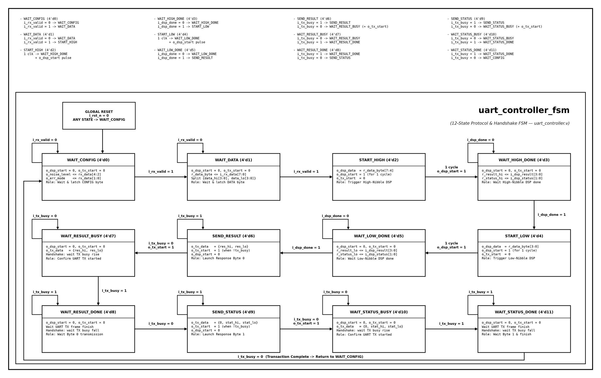

# FPGA SECDED + BPSK Communication Pipeline

Deterministic, bit-exact FPGA communication pipeline combining **Extended Hamming SECDED (8,4)**, **BPSK modulation**, **LFSR-based error/noise injection**, **UART communication**, and a **Python Golden Model** for reference-driven RTL verification.

The project is implemented in synthesizable Verilog and verified from individual DSP blocks up to the complete UART-visible system. Vivado synthesis and implementation are also completed for timing, utilization, routing, and power analysis.

> **Project scope:** RTL simulation, deterministic model-based verification, and post-implementation analysis. Physical FPGA deployment and board-level measurements are intentionally outside the final scope.

---

## Highlights

- Extended Hamming **SECDED (8,4)** encoder/decoder
- Deterministic **single-bit and double-bit error injection**
- Signed digital-baseband **BPSK mapping**: `0 -> +127`, `1 -> -127`
- **8 samples/bit**, 64 samples/codeword
- Deterministic signed **LFSR noise injection with saturation**
- Correlation-based BPSK demodulator with **11-bit signed accumulator**
- Stateful Python Golden Model with bit-exact RTL references
- Standalone verification for all six DSP stages
- Full white-box `tx_rx_dsp_top` integration verification
- Black-box UART end-to-end verification through `fpga_top`
- Vivado post-implementation timing, resource, routing, and power analysis

---

## System Architecture

```text
UART RX
   |
   v
UART Controller
   |
   v
SECDED Encoder
   |
   v
Bit-Flip Channel
   |
   v
BPSK Modulator
   |
   v
LFSR Noise Injector
   |
   v
BPSK Demodulator
   |
   v
SECDED Decoder
   |
   v
UART Controller
   |
   v
UART TX
```

### FPGA top-level interface



`fpga_top.v` exposes:

- `i_clk` — 50 MHz system clock
- `i_rst_n` — synchronous active-low reset
- `i_uart_rx` — serial UART input
- `o_uart_tx` — serial UART output

### FPGA top-level internal architecture



The top level integrates `uart_rx.v`, `uart_controller.v`, `tx_rx_dsp_top.v`, and `uart_tx.v`.

The UART controller receives configuration/data bytes, processes the high and low nibbles sequentially through the same stateful DSP pipeline, then transmits packed result and status bytes.

### UART controller FSM



`uart_controller.v` implements a **12-state FSM** that coordinates CONFIG/DATA reception, high- and low-nibble DSP transactions, result/status packing, and UART response transmission.

### DSP architecture


| Stage | RTL module | Function |
|---|---|---|
| 1 | `hamming_encoder.v` | Encode 4-bit payload into SECDED (8,4) codeword |
| 2 | `bit_flip_channel.v` | Inject 0, 1, or 2 deterministic bit errors |
| 3 | `bpsk_modulator.v` | Generate 64 signed BPSK samples |
| 4 | `lfsr_noise_injector.v` | Add deterministic signed noise with saturation |
| 5 | `bpsk_demodulator.v` | Accumulate 8 samples/bit and recover the codeword |
| 6 | `hamming_decoder.v` | Correct single-bit errors and detect double-bit errors |

---

## Design Parameters

| Parameter | Value |
|---|---|
| Target clock | 50 MHz (`20 ns`) |
| UART | 115200 baud, 8-N-1 |
| `CLKS_PER_BIT` | 434 |
| Payload width | 4 bits |
| SECDED codeword | 8 bits |
| BPSK mapping | `0 -> +127`, `1 -> -127` |
| Bit ordering | MSB-first |
| Samples per bit | 8 |
| Samples per codeword | 64 |
| Sample format | signed 8-bit |
| Saturation range | `[-128, +127]` |
| Noise levels | `0, 4, 8, 16, 24, 32, 48, 64` |
| Error LFSR seed | `0xA5` |
| Noise LFSR seed | `0x01` |
| LFSR feedback | `state[7] ^ state[5] ^ state[4] ^ state[3]` |
| Demodulation rule | `sum >= 0 -> 0`, `sum < 0 -> 1` |
| Demodulator accumulator | signed 11-bit |

Both LFSRs use their **current state before advancing**. The error LFSR advances once per valid codeword transaction, while the noise LFSR advances once per valid sample. LFSR state persists across consecutive transactions until reset.

---

## SECDED Error Modes

| `i_err_mode` | Injected error | Decoder outcome |
|---|---|---|
| `00` | no bit flip | `00` — no error |
| `01` | one bit flip | `01` — corrected |
| `10` | two distinct bit flips | `10` — double-bit error detected |
| `11` | reserved / no flip | `00` — no error |

---

## Verification

Verification is reference-driven:

```text
Specification
    ->
Python Golden Model
    ->
Deterministic HEX / CSV vectors
    ->
RTL
    ->
Self-checking testbenches
```

### Standalone RTL verification

| Module | Result |
|---|---:|
| `hamming_encoder.v` | **PASS — 69 checks, 0 errors** |
| `bit_flip_channel.v` | **PASS — 1,537 checks, 0 errors** |
| `bpsk_modulator.v` | **PASS** |
| `lfsr_noise_injector.v` | **PASS** |
| `bpsk_demodulator.v` | **PASS** |
| `hamming_decoder.v` | **PASS — 1,954 checks, 0 errors** |

### Full DSP integration

The `tx_rx_dsp_top` testbench performs a **white-box stage-by-stage comparison** against Python-generated references.

```text
tx_rx_dsp_top checks: 154373, errors: 0
Transactions: 384
BPSK/noise samples: 24576
PASS: tb_tx_rx_dsp_top
```

### UART end-to-end verification

The final black-box `tb_fpga_top.sv` testbench drives only the external UART RX input and observes only the external UART TX output.

```text
fpga_top end-to-end requests: 96
Equivalent DSP transactions: 192
fpga_top checks: 577, errors: 0
PASS: tb_fpga_top
Simulation completion time: 898750 ns
```

For faster simulation, the UART timing parameter is overridden to `CLKS_PER_BIT = 8`; the synthesizable hardware default remains `434`.

---

## UART Request / Response Protocol

### Request

```verilog
config = {3'b000, noise_level[2:0], err_mode[1:0]};
data   = {data_hi[3:0], data_lo[3:0]};
```

The controller processes the high nibble first, then the low nibble.

### Response

```verilog
response_byte0 = {result_hi[3:0], result_lo[3:0]};
response_byte1 = {4'b0000, status_hi[1:0], status_lo[1:0]};
```

Status codes:

```text
00 -> no error
01 -> single-bit error corrected
10 -> double-bit error detected
```

---

## Verification Dataset

The exported regression covers:

```text
16 payload values
x 8 noise levels
x 3 useful error modes
= 384 DSP transactions
```

Each transaction contains:

```text
8 encoded bits x 8 samples/bit = 64 samples
```

Total:

```text
384 x 64 = 24,576 samples
```

Reference data include:

- `transactions.csv`
- `uart_transactions.csv`
- encoded/corrupted codewords
- decoder outputs/status
- error-LFSR before/after states
- noise-LFSR before/after states
- `bpsk_tx.hex`
- `noise_values.hex`
- `bpsk_noisy.hex`

See [`data/README.md`](data/README.md) for ordering and `$readmemh` usage.

---

## Noise-Model Limitation

The current deterministic noise range **cannot independently flip BPSK sample polarity**.

```text
+127 - 64 = +63
-127 + 64 = -63
```

Therefore, positive samples remain positive and negative samples remain negative.

The current noise path is intended to verify deterministic LFSR sequencing, signed arithmetic, saturation, sample-level Python/RTL equivalence, and demodulator behavior.

It is **not** an AWGN model and the current project is **not a BER-vs-SNR benchmark**.

---

## Post-Implementation Results

| Metric | Result |
|---|---:|
| Post-synthesis LUTs | 177 |
| Post-implementation LUTs | **165** |
| Flip-flops | **213** |
| BRAM | **0** |
| URAM | **0** |
| DSP | **0** |
| WNS | **+17.949 ns** |
| TNS | **0.000 ns** |
| WHS | **+0.039 ns** |
| THS | **0.000 ns** |
| Routable nets | **328 / 328 routed** |
| Routing errors | **0** |
| Estimated on-chip power | **0.289 W** |

The implemented design satisfies the defined 50 MHz timing constraint.

A slack-derived critical-path estimate is:

```text
20 ns - 17.949 ns = 2.051 ns
```

This corresponds to approximately `488 MHz` by reciprocal calculation, but it is only a **timing-report-derived estimate**, not a validated maximum FPGA operating frequency.

The reported `0.289 W` is a **Vivado post-implementation estimate**, not measured board power.

---

## Quick Start

### Requirements

- Python 3.10+
- Vivado / XSim for RTL simulation
- `pytest` optional

### Run the Golden Model

```bash
python python/golden_model.py
python python/test_golden_model.py
python python/export_hex.py
```

Optional:

```bash
python -m pip install -r requirements.txt
python -m pytest python -v
```

Expected output includes:

```text
PASS: all golden-model tests
PASS: HEX vectors generated and verified
Transactions: 384
BPSK samples: 24576
HEX files: 16
```

---

## Repository Structure

```text
secDED-bpsk-fpga/
├── README.md
├── requirements.txt
├── docs/
│   ├── spec.md
│   └── images/
├── python/
│   ├── golden_model.py
│   ├── test_golden_model.py
│   └── export_hex.py
├── rtl/
│   ├── fpga_top.v
│   ├── uart_rx.v
│   ├── uart_tx.v
│   ├── uart_controller.v
│   ├── tx_rx_dsp_top.v
│   ├── hamming_encoder.v
│   ├── bit_flip_channel.v
│   ├── bpsk_modulator.v
│   ├── lfsr_noise_injector.v
│   ├── bpsk_demodulator.v
│   └── hamming_decoder.v
├── tb/
│   ├── tb_fpga_top.sv
│   ├── tb_tx_rx_dsp_top.sv
│   ├── tb_hamming_encoder.sv
│   ├── tb_bit_flip_channel.sv
│   ├── tb_bpsk_modulator.sv
│   ├── tb_lfsr_noise_injector.sv
│   ├── tb_bpsk_demodulator.sv
│   └── tb_hamming_decoder.sv
└── data/
    ├── README.md
    ├── *.hex
    ├── transactions.csv
    └── uart_transactions.csv
```

---

## Project Status

- [x] Python Golden Model and algorithm tests
- [x] Deterministic HEX/CSV vector generation
- [x] SECDED encoder/decoder RTL
- [x] Deterministic bit-flip channel
- [x] BPSK modulator
- [x] LFSR noise injector
- [x] BPSK demodulator
- [x] Standalone verification of all six DSP modules
- [x] Full `tx_rx_dsp_top` integration verification
- [x] UART RX/TX implementation
- [x] 12-state UART protocol controller
- [x] `fpga_top` system integration
- [x] UART black-box end-to-end verification
- [x] Vivado synthesis and implementation
- [x] Timing, utilization, routing, and power analysis
- [ ] Physical FPGA deployment — optional future extension

---

## Final Scope

The project is complete at the **RTL verification and post-implementation analysis** level.

The final scope does **not** include:

- FPGA board programming
- bitstream hardware validation
- physical UART measurements
- oscilloscope or logic-analyzer measurements
- measured maximum operating frequency
- measured board power

Any future FPGA-board deployment should be treated as an extension rather than unfinished work.

---

## Documentation

- [Technical Specification](docs/spec.md)
- [Verification Dataset Guide](data/README.md)