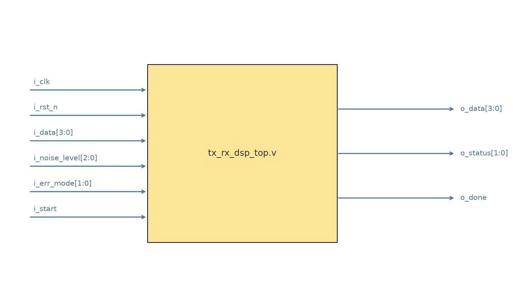
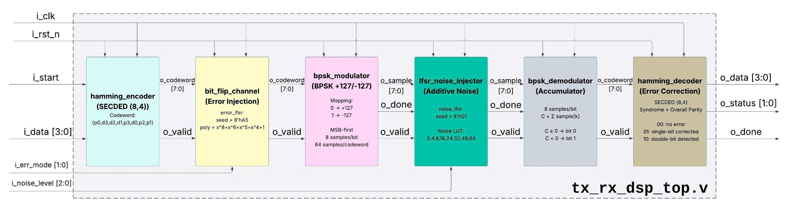

# FPGA SECDED + BPSK Communication Pipeline

Deterministic, bit-exact FPGA communication datapath combining **extended Hamming SECDED (8,4)**, **BPSK modulation**, **LFSR-based bit-error injection**, and **signed additive noise**. The project uses a Python Golden Model as the bit-exact reference for staged RTL implementation and verification.

**Implementation status:** Python Golden Model, deterministic HEX vectors, all six DSP RTL modules, and the integrated `tx_rx_dsp_top` are implemented. The full DSP pipeline has passed stage-by-stage RTL verification against the Python-generated reference dataset. **UART integration, synthesis, timing analysis, and FPGA board validation are still pending.**

## Architecture

The intended board-level flow is **UART RX → UART Controller → DSP pipeline → UART Controller → UART TX**. The figures below show the implemented `tx_rx_dsp_top.v` DSP wrapper and its six processing stages; UART remains outside this block.

### DSP top-level interface



| Input | Width | Output | Width |
|---|---:|---|---:|
| `i_clk` | 1 | `o_data` | 4 |
| `i_rst_n` | 1 | `o_status` | 2 |
| `i_data` | 4 | `o_done` | 1 |
| `i_noise_level` | 3 |  |  |
| `i_err_mode` | 2 |  |  |
| `i_start` | 1 |  |  |

`i_start` is accepted only while idle; requests are ignored while the DSP transaction is active. The payload and configuration are captured at acceptance. `o_done` is a one-clock **transaction-completion** pulse asserted with valid registered `o_data` and `o_status`.

All DSP modules use a **synchronous active-low reset** through `i_rst_n`.

### Six-stage DSP datapath



| Stage | RTL module | Function | Verification |
|---|---|---|---|
| 1 | `hamming_encoder.v` | Encode 4-bit payload into an 8-bit SECDED codeword | PASS |
| 2 | `bit_flip_channel.v` | Inject 0, 1, or 2 codeword-bit errors using error LFSR | PASS |
| 3 | `bpsk_modulator.v` | Produce 64 signed samples, MSB-first, eight per bit | PASS |
| 4 | `lfsr_noise_injector.v` | Add deterministic noise and saturate each sample | PASS |
| 5 | `bpsk_demodulator.v` | Correlate groups of eight samples to recover the codeword | PASS |
| 6 | `hamming_decoder.v` | Correct single-bit errors or detect double-bit errors | PASS |

Between modules, `valid` qualifies the current data item. **Sample-stream** `done` marks sample 63 in the modulator/noise stages; the **top-level** `o_done` marks the completed decoded transaction.

For full signal lists, bit widths, algorithms, reset rules, and cycle timing, see [the technical specification](docs/spec.md).

## Design Parameters

| Parameter | Frozen value |
|---|---|
| Target clock | 50 MHz (20 ns) |
| UART | 115200 baud, 8-N-1, `CLKS_PER_BIT = 434` |
| Payload / codeword | 4 / 8 bits |
| BPSK mapping | `0 → +127`, `1 → -127`; MSB-first |
| Sampling | 8 samples/bit; 64 samples/codeword |
| Sample type | Signed 8-bit, saturated to `[-128, 127]` |
| Noise amplitude levels 0–7 | `0, 4, 8, 16, 24, 32, 48, 64` |
| Error / noise LFSR reset seeds | `0xA5` / `0x01` |
| LFSR feedback | `state[7] ^ state[5] ^ state[4] ^ state[3]` |
| Demodulation decision | Correlation `>= 0` → bit `0`; `< 0` → bit `1` |

Both LFSRs use their **current states before advancing**. The error LFSR advances once per valid codeword; the noise LFSR advances once per valid sample, including noise level 0. Their states persist across consecutive transactions and reset only when `i_rst_n = 0`.

### Error modes and result status

| `i_err_mode` | Injection | Typical decoder status |
|---|---|---|
| `00` | No flipped bit | `00` (no error) |
| `01` | One bit flipped | `01` (corrected) |
| `10` | Two distinct bits flipped | `10` (detected, `o_data = 0` diagnostic) |
| `11` | Reserved; no flip | `00` (no error) |

Status indicates the **actual decoder outcome**, not merely the configured error mode. See [SPEC](docs/spec.md) for parity/syndrome rules and double-bit collision handling.

### Noise-model limitation

**The present noise settings do not produce demodulation bit errors.** A BPSK symbol is `+127` or `-127`, while noise magnitude is at most 64. After saturation, positive samples remain in `[63, 127]` and negative samples in `[-128, -63]`; therefore each eight-sample correlation preserves its original sign.

Bit errors observed downstream originate from the deliberate `bit_flip_channel`, **not** from the noise injector.

The noise path is currently used to verify:

- deterministic noise-LFSR ordering;
- signed arithmetic;
- saturation behavior;
- sample-level RTL/Python equivalence;
- sign-preserving BPSK demodulation.

The current dataset is **not** a BER-versus-SNR benchmark.

## RTL Verification Status

The current DSP core has passed **standalone self-checking testbenches for all six processing stages** and a full-pipeline integration testbench in Vivado XSim.

| Verification target | Result |
|---|---:|
| `hamming_encoder.v` standalone TB | **PASS — 69 checks, 0 errors** |
| `bit_flip_channel.v` standalone TB | **PASS — 1,537 checks, 0 errors** |
| `bpsk_modulator.v` standalone TB | **PASS** |
| `lfsr_noise_injector.v` standalone TB | **PASS** |
| `bpsk_demodulator.v` standalone TB | **PASS** |
| `hamming_decoder.v` standalone TB | **PASS — 1,954 checks, 0 errors** |
| `tx_rx_dsp_top.v` full integration TB | **PASS — 154,373 checks, 0 errors** |
| Full DSP transactions | **384 / 384 PASS** |
| BPSK/noise samples checked | **24,576** |

The integration testbench is a **white-box stage-by-stage comparison**. It checks intermediate RTL results against all available Python Golden Model HEX references, including:

- encoded codewords;
- corrupted codewords;
- error-LFSR before/after states;
- BPSK TX samples;
- noise values;
- noise-LFSR before/after states;
- noisy BPSK samples;
- demodulated codewords;
- decoder syndrome;
- corrected codewords;
- decoded payload;
- decoder status;
- top-level `o_data`, `o_status`, and `o_done`.

Latest full-pipeline XSim result:

```text
------------------------------------------------------------
tx_rx_dsp_top checks: 154373, errors: 0
Transactions: 384
BPSK/noise samples: 24576
PASS: tb_tx_rx_dsp_top
```

These results establish **functional RTL equivalence for the tested DSP dataset**. They do not yet constitute synthesis timing closure, FPGA hardware validation, or UART end-to-end verification.

## UART Request/Response Contract

UART integration is the next system-level stage. The host-side protocol is already frozen in the specification.

The host sends **two bytes** per request:

```verilog
config = {3'b000, noise_level[2:0], err_mode[1:0]};
data   = {data_hi[3:0], data_lo[3:0]};
```

The controller processes **high nibble first**, then low nibble, on the same stateful DSP instance.

The FPGA returns:

```verilog
response_byte0 = {result_hi[3:0], result_lo[3:0]};
response_byte1 = {4'b0000, status_hi[1:0], status_lo[1:0]};
```

Each nibble has an independent two-bit SECDED status:

- `00` — no error;
- `01` — single-bit error corrected;
- `10` — double-bit error detected.

UART RTL and host-side protocol verification are not yet included in the current PASS results.

## Quick Start

**Requirements:** Python 3.10+; the Golden Model uses the Python standard library. `pytest` is optional.

From the repository root:

```bash
python python/golden_model.py
python python/test_golden_model.py
python python/export_hex.py

# Optional
python -m pip install -r requirements.txt
python -m pytest python -v
```

Expected software output includes:

```text
PASS: all golden-model tests
PASS: HEX vectors generated and verified
Transactions: 384
BPSK samples: 24576
HEX files: 16
```

`GoldenModel` preserves both LFSR states between calls, so do not recreate it for each transaction when verifying an uninterrupted sequence.

## Verification Dataset

| Dataset property | Value |
|---|---:|
| Input payload values | 16 (`0x0`–`0xF`) |
| Noise levels | 8 |
| Error modes in exported matrix | 3 (`00`, `01`, `10`) |
| Total DSP transactions | **384** |
| BPSK TX samples | **24,576** |
| Noise samples | **24,576** |
| Noisy BPSK samples | **24,576** |
| HEX stage-reference files | **16** |
| Transaction metadata | `transactions.csv` (384 rows) |

The dataset contains transaction-level references for:

- payload and configuration;
- encoded and corrupted codewords;
- demodulated codeword;
- decoded payload and status;
- syndrome and corrected codeword;
- error/noise LFSR states before and after each transaction.

It also contains 64 sample-level values per transaction for:

- `bpsk_tx.hex`;
- `noise_values.hex`;
- `bpsk_noisy.hex`.

Signed samples are stored as 8-bit two's-complement HEX bytes.

See [data/README.md](data/README.md) for exact ordering, file definitions, and `$readmemh` usage.

## Repository Structure

```text
secDED-bpsk-fpga/
├── README.md
├── requirements.txt
│
├── docs/
│   ├── spec.md
│   └── images/
│       ├── tx_rx_dsp_top_interface.png
│       └── tx_rx_dsp_top_architecture.png
│
├── python/
│   ├── golden_model.py
│   ├── test_golden_model.py
│   └── export_hex.py
│
├── rtl/
│   ├── tx_rx_dsp_top.v
│   ├── hamming_encoder.v
│   ├── bit_flip_channel.v
│   ├── bpsk_modulator.v
│   ├── lfsr_noise_injector.v
│   ├── bpsk_demodulator.v
│   └── hamming_decoder.v
│
├── tb/
│   ├── tb_hamming_encoder.sv
│   ├── tb_bit_flip_channel.sv
│   ├── tb_bpsk_modulator.sv
│   ├── tb_lfsr_noise_injector.sv
│   ├── tb_bpsk_demodulator.sv
│   ├── tb_hamming_decoder.sv
│   └── tb_tx_rx_dsp_top.sv
│
└── data/
    ├── README.md
    ├── *.hex
    └── transactions.csv
```

## Roadmap

- [x] Python Golden Model and algorithm tests
- [x] Deterministic HEX vector export and dataset documentation
- [x] Algorithm, RTL interface, reset, and timing contracts in `docs/spec.md`
- [x] Implement six-stage SECDED + BPSK DSP RTL
- [x] Verify Hamming encoder against Golden Model
- [x] Verify deterministic bit-flip channel and error LFSR
- [x] Verify BPSK modulator with standalone self-checking testbench
- [x] Verify LFSR noise injector with standalone self-checking testbench
- [x] Verify BPSK demodulator with standalone self-checking testbench
- [x] Verify Hamming decoder exhaustively and against Golden vectors
- [x] Verify all six DSP stages independently
- [x] Verify full `tx_rx_dsp_top` stage-by-stage against all HEX references
- [ ] Implement and verify UART RX/TX and controller
- [ ] Run synthesis, implementation, timing, and resource-utilization analysis
- [ ] Validate on FPGA hardware and publish measured results

**Reference documentation:** [Technical SPEC](docs/spec.md) · [Dataset Guide](data/README.md)
